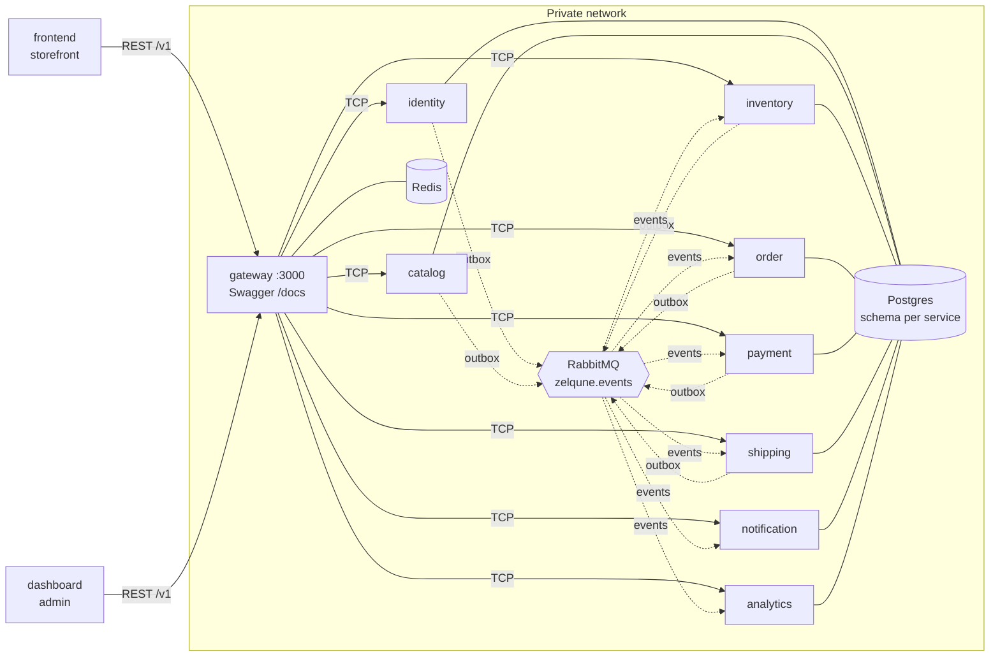

<div align="center">


# ZELQUNE

**Handcrafted wood and light for modern homes — e-commerce platform**

[](https://github.com/MD-ALL-SHAHRIA/ZELQUNE/actions/workflows/backend.yml)
[](https://github.com/MD-ALL-SHAHRIA/ZELQUNE/actions/workflows/frontend.yml)
[](https://github.com/MD-ALL-SHAHRIA/ZELQUNE/actions/workflows/dashboard.yml)
<br />


</div>

---

## Table of contents

- [About](#about)
- [Architecture](#architecture)
- [Tech stack](#tech-stack)
- [Repository structure](#repository-structure)
- [Getting started](#getting-started)
- [Scripts](#scripts)
- [Environment variables](#environment-variables)
- [Testing](#testing)
- [Git workflow](#git-workflow)
- [Roadmap](#roadmap)
- [License](#license)

## About

Zelqune makes handcrafted wood and light pieces for the home, starting with the Alo-Arch panel.
This repository holds the complete online shop: a Bangla-first storefront, an admin dashboard,
and a microservice backend for catalog, stock, orders, payments (COD and bKash/Nagad), delivery,
notifications and analytics.

Products sell in one of three modes — **in stock**, **made to order** or **pre-order** — so the
first pre-order test runs on the same platform that later becomes the full store.

- Scope and milestones: [docs/website-build-plan.md](docs/website-build-plan.md)
- Pre-order test rules: [docs/website-spec.md](docs/website-spec.md)
- Architecture and decisions: [docs/architecture.md](docs/architecture.md), [docs/adr/](docs/adr/README.md)

## Architecture



- Only the **gateway** is public. Services listen on a private network (TCP) and expose `/health`.
- Each service owns **one Postgres schema** and connects with its own role, so it cannot read
  other services' tables.
- Events use a **transactional outbox** and **idempotent consumers** (at-least-once, no double
  effects). Dead letters go to `<service>.events.dlq`.
- Every request carries an **`x-request-id`** through HTTP, TCP and events.

## Tech stack

| Layer | Technology |
|---|---|
| Backend | NestJS 11 (monorepo mode), TypeScript 5.9 strict, Prisma 7 + `@prisma/adapter-pg` |
| Messaging | RabbitMQ 4 (topic exchange, DLQs), `amqp-connection-manager` |
| Data | PostgreSQL 17 (schema per service), Redis 7 (idempotency, rate limits) |
| API | REST `/v1`, OpenAPI via `@nestjs/swagger`, zod contracts |
| Frontend / dashboard | Next.js App Router, Tailwind + shadcn/ui (steps 1.4 / 1.5) |
| Shared packages | `@zelqune/api-client` (openapi-typescript + openapi-fetch), `@zelqune/ui-tokens` |
| Tooling | pnpm 9 workspaces, Turborepo, ESLint 9, Prettier, Jest, Supertest |
| Infra | Docker Compose (dev); single VPS + Vercel planned (step 1.6) |

## Repository structure

```
ZELQUNE/
├─ backend/                 NestJS microservices (Nest monorepo)
│  ├─ apps/gateway/         public REST /v1, Swagger, aggregated /health
│  ├─ apps/*-service/       identity, catalog, inventory, order, payment,
│  │                        shipping, notification, analytics (TCP + /health, Prisma)
│  └─ libs/                 common (config, logger, errors, health, idempotency,
│                           outbox, messaging), contracts (events, RPC)
├─ frontend/                Next.js storefront (placeholder)
├─ dashboard/               Next.js admin (placeholder)
├─ packages/
│  ├─ api-client/           types generated from gateway OpenAPI
│  └─ ui-tokens/            brand colors, typography, Tailwind theme
├─ infra/                   docker-compose (dev), Dockerfile, Postgres init
├─ docs/                    build plan, spec, architecture, ADRs
├─ assets/brand/            logo
└─ .github/                 CI workflows, templates, CODEOWNERS, Dependabot
```

## Getting started

**Prerequisites:** Node 20 (`nvm use`), pnpm 9 (`corepack enable`), Docker Desktop (about 2 GB free disk).

```sh
git clone https://github.com/MD-ALL-SHAHRIA/ZELQUNE.git && cd ZELQUNE
pnpm install          # all workspaces + Prisma clients
pnpm keys:dev         # dev-only JWT keys + storage secret into infra/.env (gitignored)
# set OWNER_PHONE / OWNER_PASSWORD (>= 12 chars) / OWNER_NAME in infra/.env
pnpm infra:up         # build and start Postgres, RabbitMQ, Redis and all 9 backend apps
pnpm seed             # OWNER admin + the Alo-Arch Panel pre-order catalog (idempotent)
pnpm health           # every /health should return 200
```

Try it: `curl 'http://localhost:3000/v1/catalog/products/alo-arch-panel?p=b'` (price experiment
b = ৳4,290), or sign in with `POST /v1/admin/auth/login` in Swagger at http://localhost:3000/docs.

<details>
<summary><b>URLs and ports (all bound to 127.0.0.1)</b></summary>

| What | URL |
|---|---|
| Gateway API | http://localhost:3000/v1 |
| Swagger UI / OpenAPI JSON | http://localhost:3000/docs · http://localhost:3000/docs-json |
| Gateway health (includes all services) | http://localhost:3000/health |
| Service health | http://localhost:3001/health … http://localhost:3008/health |
| RabbitMQ management | http://localhost:15672 (zelqune / zelqune_dev) |
| Postgres | localhost:5432, db `zelqune` |
| Redis | localhost:6379 |

| Service | HTTP | TCP | Schema |
|---|---|---|---|
| identity | 3001 | 4001 | identity |
| catalog | 3002 | 4002 | catalog |
| inventory | 3003 | 4003 | inventory |
| order | 3004 | 4004 | orders |
| payment | 3005 | 4005 | payments |
| shipping | 3006 | 4006 | shipping |
| notification | 3007 | 4007 | notifications |
| analytics | 3008 | 4008 | analytics |

</details>

<details>
<summary><b>Run one backend app outside Docker</b></summary>

```sh
pnpm infra:up                                    # or just postgres, rabbitmq, redis
docker compose -f infra/docker-compose.yml stop catalog-service
cp backend/apps/catalog-service/.env.example backend/apps/catalog-service/.env
pnpm --filter @zelqune/backend start:dev catalog-service
```

</details>

Stop everything with `pnpm infra:down` (data is kept; add `-v` to the compose command to wipe it).

## Scripts

| Command | Description |
|---|---|
| `pnpm lint` / `pnpm typecheck` / `pnpm test` | run across all workspaces (Turborepo) |
| `pnpm build` | build all workspaces |
| `pnpm format` / `pnpm format:check` | Prettier |
| `pnpm infra:up` / `pnpm infra:down` / `pnpm infra:logs` | dev stack |
| `pnpm health` | curl every `/health` |
| `pnpm keys:dev` | generate dev JWT keys and storage secret into `infra/.env` |
| `pnpm seed` | seed OWNER admin and catalog in the running stack |
| `pnpm gen:api` | export gateway OpenAPI and regenerate `@zelqune/api-client` |
| `pnpm --filter @zelqune/<pkg> <script>` | run a script in one workspace |

## Environment variables

Secrets live only in environment variables; only `.env.example` files are committed.

- Docker stack overrides: [`infra/.env.example`](infra/.env.example) → copy to `infra/.env`
- Gateway: [`backend/apps/gateway/.env.example`](backend/apps/gateway/.env.example)
- Each service: `backend/apps/<service>/.env.example`, e.g. [catalog](backend/apps/catalog-service/.env.example)

All variables are validated at startup with zod; an app refuses to boot with a clear list of
what is missing or invalid.

## Testing

```sh
pnpm test                                   # everything
pnpm --filter @zelqune/backend test:cov     # backend with coverage
```

- **Unit:** `libs/common` (config, request id, error filter, idempotency, outbox relay, idempotent
  consumer, RPC client) and `libs/contracts` (event envelope contract).
- **e2e (mocked services):** every app's `/health`; gateway Swagger, routing, error format,
  request ids, guards, cookies, rate limits.
- **End-to-end on real infrastructure** (`pnpm --filter @zelqune/backend test:integration`, needs
  `pnpm infra:up` locally; service containers in CI): gateway + identity + catalog over TCP on
  Postgres, RabbitMQ and Redis.
- CI runs lint, typecheck and tests per area on every PR, plus build and an OpenAPI drift check
  for the backend.

## Git workflow

<details>
<summary><b>Branches, commits and pull requests</b></summary>

- Never commit directly to `main`; one branch per task:
  `feat/<area>-<short-desc>`, `fix/…`, `chore/…`, `docs/…` with area
  `backend | frontend | dashboard | infra | repo`.
- Small [Conventional Commits](https://www.conventionalcommits.org/): `feat(backend): …`,
  `chore(infra): …`.
- Push and open a PR to `main` with the template; CI must pass; the owner reviews and
  squash-merges.
- No force-push to `main`, no rewriting pushed history, no secrets in Git.
- Significant architecture choices are recorded as ADRs in [docs/adr/](docs/adr/README.md).

See [CONTRIBUTING.md](CONTRIBUTING.md).

</details>

## Roadmap

<details open>
<summary><b>M1 — Start selling</b> (pre-order test + first sales)</summary>

- [x] 1.0 Monorepo and backend skeleton (gateway, 8 services, outbox, messaging, CI)
- [x] 1.1 identity and catalog services (admin auth, products, sale modes, price experiment)
- [ ] 1.2 inventory, order, payment, shipping + checkout saga
- [ ] 1.3 analytics, notification and admin API (GO counter, audit log)
- [ ] 1.4 Storefront (product page, cart, guest checkout, COD / bKash, tracking, Pixel)
- [ ] 1.5 Admin dashboard (orders, payment verification, products, GO counter)
- [ ] 1.6 Production readiness (Dockerfiles, VPS compose, HTTPS, backups, OpenTelemetry, Sentry)

</details>

<details>
<summary><b>M2 — Full shop</b></summary>

- [ ] OTP accounts, stock reservations, coupons
- [ ] Categories, filters and search, CMS
- [ ] Invoices and reports

</details>

<details>
<summary><b>M3 — Automation</b></summary>

- [ ] Payment gateways (SSLCommerz, bKash PGW), courier APIs, SMS notifications
- [ ] Verified reviews, Conversions API, returns and refunds

</details>

<details>
<summary><b>M4 — Growth</b></summary>

- [ ] English edition, international shipping, interior consultation booking

</details>

## License

Proprietary. Copyright (c) 2026 Zelqune. All rights reserved. See [LICENSE](LICENSE).
