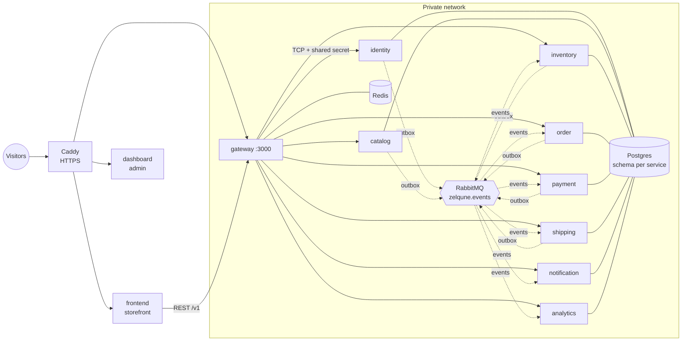

<div align="center">


# ZELQUNE

**Handcrafted wood and warm light for the home, made to order in Dhaka.**<br />
The complete online shop: storefront, admin dashboard and microservice backend.

[](https://github.com/MD-ALL-SHAHRIA/ZELQUNE/actions/workflows/backend.yml)
[](https://github.com/MD-ALL-SHAHRIA/ZELQUNE/actions/workflows/frontend.yml)
[](https://github.com/MD-ALL-SHAHRIA/ZELQUNE/actions/workflows/dashboard.yml)
[](https://github.com/MD-ALL-SHAHRIA/ZELQUNE/actions/workflows/security.yml)
<br />


[Status](#project-status) · [Architecture](#architecture) · [Getting started](#getting-started) · [Deploy](docs/deploy.md) · [Roadmap](#roadmap)

</div>

---

## About

Zelqune makes handcrafted wood and light pieces for the home: wall panels, shelves and lamps.
This repository is the whole shop: a bilingual storefront (English and Bangla), an admin
dashboard for the owner and staff, and a microservice backend for catalog, stock, orders,
payments (cash on delivery and bKash/Nagad), delivery, notifications and analytics.

Every product sells in one of three modes: **in stock**, **made to order** or **pre-order**
(a ৳300 advance). The site never invents reviews, ratings, sold counts or countdowns.

## Project status

> **Ready for launch after the owner's setup steps.** The code has passed a full
> pre-deployment audit; no critical or high issues are open.
> Checklist: [docs/audit/pre-deployment-checklist.md](docs/audit/pre-deployment-checklist.md)

| Area | State | Notes |
|---|---|---|
| Storefront | ✅ Done | `/en` + `/bn`, shop, filters, search, product pages, cart, guest and account checkout with Daraz-style area lists and saved addresses, COD / bKash advance, order tracking, order and account emails (EN/BN), interior design, construction, bulk requests, privacy requests, Google/Facebook sign-in |
| Admin dashboard | ✅ Done | Orders and payment checks, products, stock, home page editing, coupons and flash sales, customers, quotes, finance (expenses, P&L), analytics, audit log, team and settings |
| Backend | ✅ Done | Gateway + 8 services, outbox messaging, idempotency, rate limits, signed uploads |
| Quality | ✅ Audited | Code quality, security, performance and load tests ([docs/audit/](docs/audit)) |
| Production kit | ✅ Ready | Caddy HTTPS, production compose, backups and restore, deploy guide ([docs/deploy.md](docs/deploy.md)) |
| Email | ✅ Ready | Resend set up and verified for support@zelqune.com; the key goes on the server at deploy ([docs/email.md](docs/email.md)) |
| Server and domain | 👤 Owner | Buy the VPS, add DNS records, Turnstile keys |
| Live payments and couriers | 🔜 M3 | bKash PGW / SSLCommerz and courier APIs (placeholders today) |

**Measured** (local, production build): Lighthouse desktop 99–100, mobile 88–92, accessibility
100; ~350 pages/s per storefront process and ~2,300 API requests/s with zero errors up to 1,000
users at once ([load test](docs/audit/load-test.md)).

## Architecture



- Only Caddy is public (80/443). The gateway is the only API entry; services talk over a private
  network with a shared secret (ADR 0024) and expose `/health`.
- Each service owns **one Postgres schema** with its own role, so it cannot read other
  services' tables.
- Events use a **transactional outbox** and **idempotent consumers** (at-least-once, no double
  effects). Dead letters go to `<service>.events.dlq`.
- Every request carries an `x-request-id` through HTTP, TCP and events.
- Decisions are recorded as ADRs: [docs/adr/](docs/adr/README.md).

## Tech stack

| Layer | Technology |
|---|---|
| Storefront | Next.js 16 App Router (ISR), React 19, Tailwind CSS 4, Redux Toolkit, CSS scroll-driven motion |
| Dashboard | Next.js 16, React 19, TanStack Table |
| Backend | NestJS 11 (monorepo), TypeScript 5.9 strict, Prisma 7 + `@prisma/adapter-pg`, zod contracts |
| Messaging | RabbitMQ 4 (topic exchange, DLQs) |
| Data | PostgreSQL 17 (schema per service), Redis 7 (cache, idempotency, rate limits) |
| Auth | ES256 JWT (15 min) + rotating httpOnly refresh cookies, argon2id passwords, Turnstile |
| Shared packages | `@zelqune/api-client` (generated from OpenAPI), `@zelqune/ui-tokens` (brand tokens) |
| Tooling | pnpm 9 workspaces, Turborepo, ESLint 9, Prettier, Jest, Vitest, Playwright |
| Infra | Docker Compose, Caddy (automatic HTTPS), one VPS ([ADR 0025](docs/adr/0025-single-vps-production.md)) |

## Repository structure

```
ZELQUNE/
├─ frontend/        Next.js storefront (EN + BN)
├─ dashboard/       Next.js admin for owner and staff (port 3200)
├─ backend/         NestJS microservices
│  ├─ apps/         gateway + identity, catalog, inventory, order, payment,
│  │                shipping, notification, analytics
│  └─ libs/         common (config, logging, errors, outbox, messaging), contracts
├─ packages/        api-client (generated), ui-tokens (brand colours and type)
├─ infra/           dev and production compose, Dockerfiles, Caddy, backup scripts
├─ docs/            build plan, architecture, ADRs, audits, deploy guide, copy
└─ .github/         CI, security audit, templates, Dependabot
```

## Getting started

**Needs:** Node 20 (`nvm use`), pnpm 9 (`corepack enable`), Docker Desktop.

```sh
git clone https://github.com/MD-ALL-SHAHRIA/ZELQUNE.git && cd ZELQUNE
pnpm install          # all workspaces + Prisma clients
pnpm keys:dev         # dev-only secrets into infra/.env (gitignored)
# set OWNER_PHONE / OWNER_PASSWORD (12+ chars) / OWNER_NAME in infra/.env
pnpm infra:up         # Postgres, RabbitMQ, Redis and all 9 backend apps
pnpm seed             # owner account + catalog (safe to rerun)
pnpm health           # every /health should return 200
pnpm --filter @zelqune/frontend dev    # storefront  → http://localhost:3100/en
pnpm --filter @zelqune/dashboard dev   # dashboard   → http://localhost:3200
```

<details>
<summary><b>Local URLs and ports (all bound to 127.0.0.1)</b></summary>

| What | URL |
|---|---|
| Storefront / dashboard | http://localhost:3100/en · http://localhost:3200 |
| Gateway API · Swagger | http://localhost:3000/v1 · http://localhost:3000/docs |
| Health (all services) | http://localhost:3000/health |
| Test inbox (Mailpit) | http://localhost:8025 |
| RabbitMQ management | http://localhost:15672 |

| Service | HTTP | TCP | Schema |
|---|---|---|---|
| identity | 3001 | 4001 | identity |
| catalog | 3002 | 4002 | catalog |
| inventory | 3003 | 4003 | inventory |
| order | 3004 | 4004 | orders |
| payment | 3005 | 4005 | payments |
| shipping | 3006 | 4006 | shipping |
| notification | 3007 | 4007 | notifications |
| analytics | 3008 | 4008 | analytics |

</details>

Stop with `pnpm infra:down` (data is kept). To go live, follow [docs/deploy.md](docs/deploy.md).

## Scripts

| Command | What it does |
|---|---|
| `pnpm lint` · `pnpm typecheck` · `pnpm test` · `pnpm build` | all workspaces (Turborepo) |
| `pnpm format` · `pnpm format:check` | Prettier |
| `pnpm infra:up` · `pnpm infra:down` · `pnpm infra:logs` · `pnpm health` | dev stack |
| `pnpm keys:dev` | dev secrets into `infra/.env` (`--prod` for a fresh production set) |
| `pnpm seed` | owner account and catalog |
| `pnpm gen:api` | regenerate `@zelqune/api-client` after an API change |

## Quality and testing

- **Every PR:** lint, typecheck, format, unit and e2e tests, builds, OpenAPI drift check,
  storefront end-to-end flows (Playwright) and a dependency audit.
- **Backend:** 370+ unit/e2e tests and 64 integration tests on real Postgres, RabbitMQ and Redis.
- **Storefront:** sign-up, sign-in, password reset, guest and pre-order checkout, tracking,
  search, filters, consent, requests and the admin flow, end to end.
- **Audits:** [pre-deployment checklist](docs/audit/pre-deployment-checklist.md),
  [code quality](docs/audit/code-quality.md), [security](docs/audit/02-final-report.md),
  [performance](docs/audit/frontend-performance.md), [load test](docs/audit/load-test.md).

Secrets live only in environment variables; only `.env.example` files are committed, and every
app validates its config at startup.

## Roadmap

**M1 · Start selling**

- [x] Monorepo, gateway and 8 services, outbox messaging, CI
- [x] Catalog, stock, orders, payments, shipping, checkout saga, analytics, notifications
- [x] Storefront (EN + BN), guest checkout, COD and bKash advance, tracking, bulk requests
- [x] Admin dashboard: orders, payment checks, products, home page, coupons, finance, team
- [x] Pre-deployment audit, production kit, load test
- [x] Order and account emails (Resend), Daraz-style delivery, saved addresses
- [ ] Go live: VPS, DNS, Turnstile (owner, [docs/deploy.md](docs/deploy.md))

**M2 · Full shop**

- [x] Categories, filters, search, coupons, flash sales, reports, B2B quotes
- [ ] B2B accounts, wholesale price lists, MOQ, PDF quotes and invoices
- [ ] TOTP 2FA for owner and staff
- [ ] Error tracking (Sentry) and uptime monitoring (needs the owner's sign-up)

**M3 · Automation**

- [ ] bKash PGW / SSLCommerz, courier APIs (Pathao, Steadfast), paid SMS
- [ ] Verified reviews, Meta Conversions API, returns and refunds flow

**M4 · Growth**

- [ ] International shipping, more languages

## Contributing

One branch per task (`feat|fix|chore|docs/<area>-<desc>`), small
[Conventional Commits](https://www.conventionalcommits.org/), a PR to `main` with the template,
CI green, squash merge. No force-push to `main`, no secrets in Git. See
[CONTRIBUTING.md](CONTRIBUTING.md).

## License

Proprietary. Copyright (c) 2026 Zelqune. All rights reserved. See [LICENSE](LICENSE).
