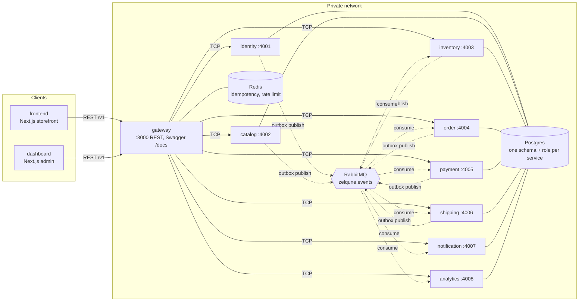
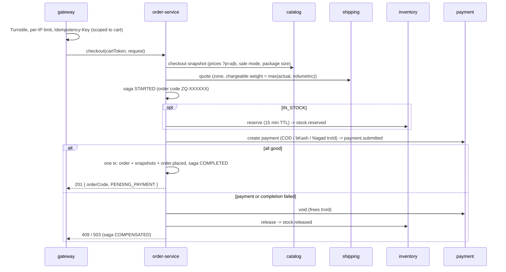
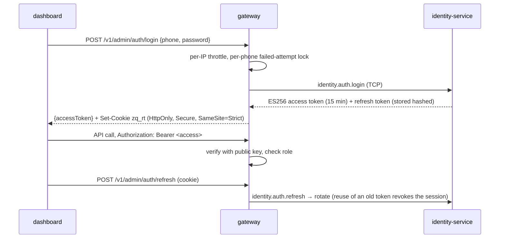

# Architecture

Source of truth for scope and features: [website-build-plan.md](website-build-plan.md).
Decisions: [adr/](adr/README.md).

## System overview



## Ports (local dev)

| App | HTTP (/health) | TCP | Postgres schema / role |
|---|---|---|---|
| gateway | 3000 (public: /v1, /docs, /docs-json) | | none (Redis) |
| identity-service | 3001 | 4001 | `identity` / `identity_svc` |
| catalog-service | 3002 | 4002 | `catalog` / `catalog_svc` |
| inventory-service | 3003 | 4003 | `inventory` / `inventory_svc` |
| order-service | 3004 | 4004 | `orders` / `orders_svc` |
| payment-service | 3005 | 4005 | `payments` / `payments_svc` |
| shipping-service | 3006 | 4006 | `shipping` / `shipping_svc` |
| notification-service | 3007 | 4007 | `notifications` / `notifications_svc` |
| analytics-service | 3008 | 4008 | `analytics` / `analytics_svc` |
| Postgres / RabbitMQ / Redis | 5432 / 5672 + 15672 UI / 6379 | | |

All ports bind to `127.0.0.1` in dev. In production only the gateway is reachable, behind a
reverse proxy with HTTPS (step 1.6).

## Request path

1. Client calls `https://api.../v1/...`. The gateway accepts or generates `x-request-id`.
2. Gateway validates auth (from step 1.1) and calls the owning service with
   `{ meta: { requestId }, data }` over TCP.
3. The service writes its schema and, in the same transaction, any events to `outbox_events`.
4. `OutboxRelay` publishes to `zelqune.events` (routing key = event type).
5. Consumers dedupe on `processed_events` and apply the change in one transaction; failures are
   dead-lettered to `<service>.events.dlq`.

## Event envelope

```json
{
  "id": "uuid",
  "type": "order.placed",
  "version": 1,
  "occurredAt": "2026-10-19T00:00:00.000Z",
  "source": "order-service",
  "requestId": "…",
  "payload": {}
}
```

Contracts are declared with `defineEvent` in `backend/libs/contracts/src/events`.

## Checkout saga (step 1.2, ADR 0008)



After checkout (events through the outbox):

| Event | Consumer -> effect |
|---|---|
| `order.placed` | inventory: reservation HELD for ORDER_HOLD_HOURS |
| `payment.verified` (staff verify trxId / confirm COD) | order: CONFIRMED -> `order.confirmed` |
| `order.confirmed` | inventory: stock committed (SALE movement) |
| `order.cancelled` (unpaid after 48h, admin) | inventory: release; payment: void |
| `stock.released` reason EXPIRED | order: cancel if still pending |

Consumers retry failed events through delay queues before the DLQ (ADR 0009).

## Admin authentication (step 1.1, ADR 0006)



The dashboard and API must be on the same site in production (`admin.<domain>` and
`api.<domain>`) for the SameSite=Strict cookie to work; see ADR 0006.

## Admin, analytics and B2B (step 1.3, ADR 0010–0011)

```mermaid
flowchart LR
  DB[dashboard] -->|/v1/admin/* JWT OWNER/STAFF| GW[gateway]
  SF[storefront] -->|/v1/events beacon, /v1/quote-requests| GW
  GW -->|actor in RPC meta| OR[order] & CA[catalog] & IN[inventory] & PA[payment] & SH[shipping]
  OR & CA & IN & PA & SH -. audit.recorded, order/payment events .-> MQ{{RabbitMQ}}
  MQ -.-> AN[analytics: funnel, revenue, GO, audit log]
  MQ -.-> NO[notification: SMS]
  GW -->|dashboard, audit log| AN
```

- GO = B2C + not isFriend + active status + VERIFIED advance > 0 (COD never counts).
- analytics stores only the HMAC `customerKey`, never phone numbers.
- B2B: RFQ -> Quote (QT-XXXXXX) -> priced (discount guard) -> accepted -> converted to a B2B
  order through the checkout saga at the quoted prices.
