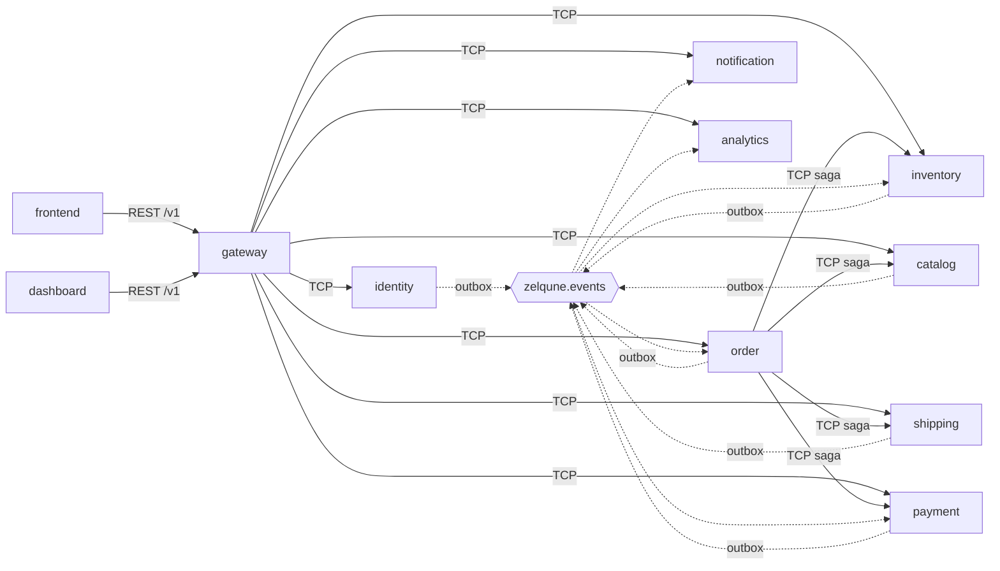

# 00 — System map (audit 2026-11-06)

The stack as built is different from the generic audit brief. Persistence is **Prisma** (ADR 0004), not Sequelize. Synchronous calls between services go over **Nest TCP transport**, not gRPC. Full design: [architecture.md](../architecture.md).

## Services

| Service | Responsibility | Entry | HTTP / TCP | Schema / role | Calls (TCP) | Publishes (outbox) | Consumes |
|---|---|---|---|---|---|---|---|
| gateway | Only public app: REST /v1, auth (JWT ES256), throttling, Turnstile, idempotency, public cache | `apps/gateway/src/main.ts` | 3000 / – | none (Redis) | all 8 services | – | – |
| identity-service | Admin + customer accounts, sessions, refresh rotation, team | `apps/identity-service/src/main.ts` | 3001 / 4001 | `identity` / `identity_svc` | – | audit.recorded, privacy.erased | – |
| catalog-service | Products, pricing, promotions, media storage, home content | `apps/catalog-service/src/main.ts` | 3002 / 4002 | `catalog` / `catalog_svc` | – | product.published, product.updated, price.changed, audit.recorded | – |
| inventory-service | Stock levels, reservations (15 min TTL), holds, commits | `apps/inventory-service/src/main.ts` | 3003 / 4003 | `inventory` / `inventory_svc` | – | stock.reserved, stock.released | order.placed, order.confirmed, order.cancelled |
| order-service | Carts, checkout saga orchestrator (ADR 0008), orders, coupons, quotes, reports | `apps/order-service/src/main.ts` | 3004 / 4004 | `orders` / `orders_svc` | catalog, shipping, inventory, payment | order.placed, order.confirmed, order.cancelled, order.statusChanged, customer.friendFlagChanged, quote.requested | payment.verified, stock.released |
| payment-service | COD + manual bKash/Nagad trxId verification | `apps/payment-service/src/main.ts` | 3005 / 4005 | `payments` / `payments_svc` | – | payment.submitted, payment.verified | order.cancelled, privacy.erased |
| shipping-service | Zones, fees (volumetric weight), shipments (manual courier) | `apps/shipping-service/src/main.ts` | 3006 / 4006 | `shipping` / `shipping_svc` | – | audit.recorded only | – |
| notification-service | SMS (console provider today), account email (SMTP/Mailpit) | `apps/notification-service/src/main.ts` | 3007 / 4007 | `notifications` / `notifications_svc` | – | – | order.placed/confirmed/cancelled/statusChanged, payment.verified, quote.requested, privacy.erased |
| analytics-service | Storefront beacons, projections, stats, finance | `apps/analytics-service/src/main.ts` | 3008 / 4008 | `analytics` / `analytics_svc` | – | – | domain events (projections) |
| frontend | Next.js storefront | `frontend/` | 3100 | – | gateway REST | – | – |
| dashboard | Next.js admin | `dashboard/` | 3200 | – | gateway REST | – | – |

Messaging: a single durable topic exchange `zelqune.events` (routing key = event type). Each service has a queue `<svc>.events`, retry delay queues `<svc>.events.retry.<ms>ms` and a DLQ `<svc>.events.dlq` (ADR 0009). The consumer side uses manual ack, prefetch 10, a `processed_events` dedupe table, and auto-reconnect via amqp-connection-manager.

## Commands and baseline (before any change, `main` @ 7d3d959)

Commands are run from the repo root: `pnpm lint`, `pnpm typecheck`, `pnpm test`, `pnpm build`. The frontend production build requires `NEXT_PUBLIC_TURNSTILE_SITE_KEY`, or `ALLOW_TEST_TURNSTILE=true` for CI and local builds.

| Check | Result |
|---|---|
| lint | pass, 0 errors. 3 warnings: 2 unused `eslint-disable` directives (frontend, dashboard) and 1 React Compiler skip (dashboard) |
| typecheck | pass (5 tasks, 14 s) |
| test | frontend 19 files pass, dashboard 2 files pass. Backend 330 tests: 308 pass, 22 fail **under load only**. All 22 failures are the 5 s jest hook timeout in the gateway e2e `beforeAll`; each suite passes when run alone (e.g. content.e2e 3/3 in 4.4 s) |
| build | backend + dashboard pass. Frontend fails without a Turnstile key (deliberate guard) and passes with `ALLOW_TEST_TURNSTILE=true` (31 s) |
| pnpm audit | 37 advisories: 2 critical, 9 high, 22 moderate, 4 low |
